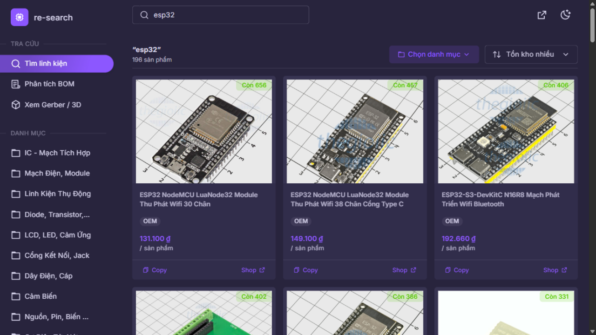
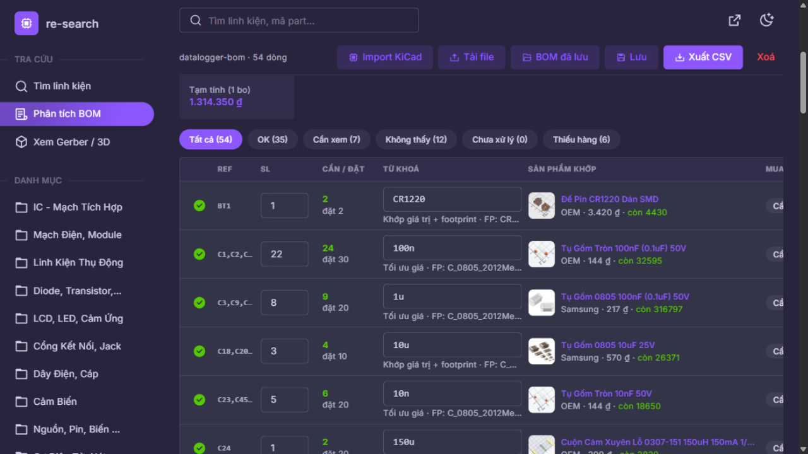
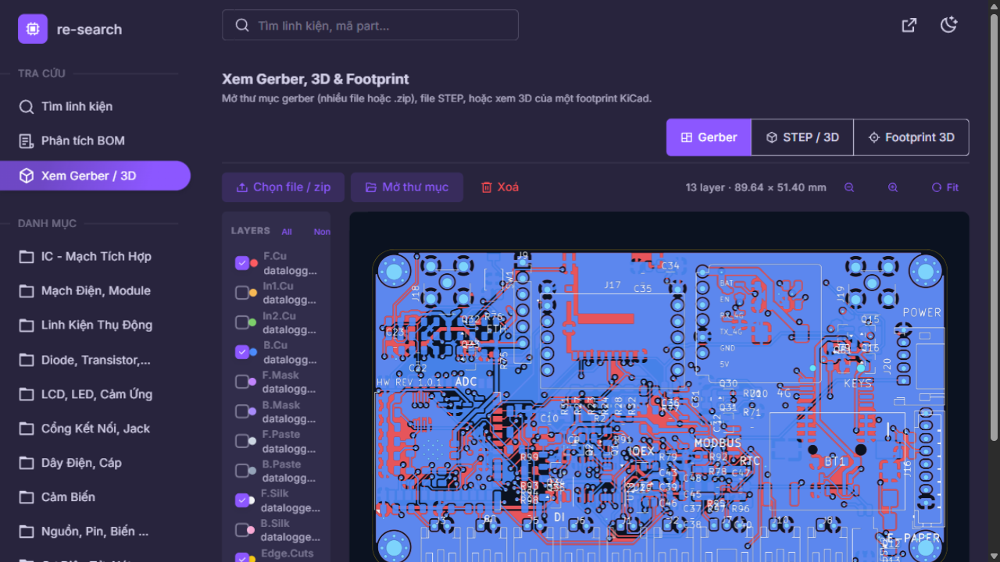
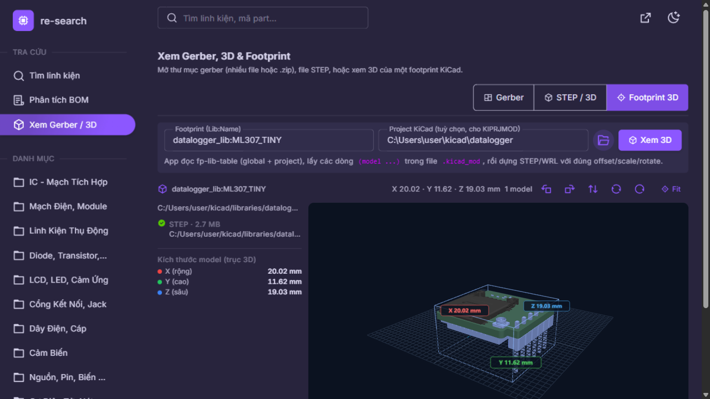

# re-search-accessory

**Tra cứu linh kiện [thegioiic.com](https://www.thegioiic.com/) và quản lý BOM ngay trên máy — nhanh, có cache offline, không cần mở trình duyệt.**

[](https://github.com/yarncode/re-search-accessory/actions/workflows/build.yml)
[](https://github.com/yarncode/re-search-accessory/releases)
[](LICENSE)


<p align="center">
  
  
</p>
<p align="center">
  
  
</p>

Ứng dụng desktop (Rust + Vue 3/Vuetify) dành cho người làm mạch: tìm đúng linh kiện trong ~1.162 danh
mục / 347 thương hiệu, rồi biến file BOM từ KiCad (hoặc CSV/Excel) thành danh sách mua hàng có giá,
tồn kho, mã JLCPCB và trạng thái đặt hàng. Toàn bộ dữ liệu nằm trên máy bạn.

> Đây là công cụ **không chính thức**, chỉ đọc dữ liệu công khai của thegioiic.com và không liên kết
> với trang. Không có tài khoản, không telemetry.

---

## ⬇️ Tải về

| Nền tảng | Tải | Ghi chú |
| --- | --- | --- |
| **Windows 10/11 x64** | **[re-search-accessory-windows-x64.zip](https://github.com/yarncode/re-search-accessory/releases/latest/download/re-search-accessory-windows-x64.zip)** | Giải nén rồi chạy `re-search-accessory.exe`. WebView2 có sẵn trên Windows 10/11. |
| **Linux x64** | **[re-search-accessory-linux-x64.tar.gz](https://github.com/yarncode/re-search-accessory/releases/latest/download/re-search-accessory-linux-x64.tar.gz)** | Cần `libwebkit2gtk-4.1-0` + `libgtk-3-0` (Ubuntu/Debian 24.04+). Trong gói có cả bản server `re-search-accessory-server`. |

Xem tất cả phiên bản tại **[Releases](https://github.com/yarncode/re-search-accessory/releases)**.
Mỗi gói kèm `README.txt` hướng dẫn chạy nhanh.

```bash
# Linux
sudo apt install libwebkit2gtk-4.1-0 libgtk-3-0
tar -xzf re-search-accessory-linux-x64.tar.gz
./re-search-accessory
```

---

## Tính năng

### Tra cứu linh kiện
- Tìm theo tên / mã part, gợi ý khi gõ, sắp xếp theo giá hoặc tồn kho.
- Duyệt **1.162 danh mục** theo từng cấp (dialog mở tức thì), lọc theo **thương hiệu**, **còn hàng**,
  thuộc tính (điện áp, kiểu chân, dung sai…).
- Xem chi tiết sản phẩm với thông số kỹ thuật trích từ trang sản phẩm, ảnh, giá VND, tồn kho.
- Nhãn **HẾT HÀNG** rõ ràng, nút Copy tên và mở thẳng trang shop.

### Quản lý BOM (điểm mạnh)
- **Import trực tiếp KiCad** (`kicad-cli sch export bom`): tự nhận `Reference / Value / Footprint`,
  bỏ qua dòng DNP. Hỗ trợ cả **CSV và Excel**.
- **Khớp thông minh**: chấm điểm theo mã hãng (MPN), giá trị (Value) và **footprint** (0805, SOIC-8,
  SOT-23…), gắn nhãn *Khớp giá trị + footprint / Khác footprint / Chỉ khớp footprint*.
- **Số bo + hao hụt**: tính số lượng cần, làm tròn theo MOQ/bội số, cảnh báo **thiếu hàng**.
- **Tối ưu giá**: chọn phương án rẻ nhất còn đủ hàng, báo số tiền tiết kiệm.
- **So sánh JLCPCB** offline từ database của Konnect (`jlcpcb.db`, ~803k part): giá USD, tồn kho, chênh lệch.
- **Trạng thái mua hàng**: Cần mua → Đã đặt → Đã nhận, kèm ngày đặt và nơi mua.
- **Linh kiện thay thế** gợi ý từ API, chọn tay bằng ô tìm kiếm riêng cho từng dòng.
- **Tự lưu**: thay đổi được ghi vào SQLite sau ~0.5 s (kể cả khi đóng app), có **undo/redo** (Ctrl+Z),
  mở lại BOM cũ bất cứ lúc nào. Nút Lưu chỉ dùng để đặt tên — sau đó mọi sửa đổi tự động lưu.

### Gerber · STEP · Footprint 3D
- **Gerber**: mở thư mục/chọn nhiều file/`.zip`; tự nhận F/B.Cu, In1/In2, Mask, Paste, Silk,
  Edge.Cuts, PTH/NPTH. Mỗi layer được dựng thành texture và vẽ bằng **WebGL** — pan/zoom mượt,
  không giật như chồng SVG.
- **STEP**: dựng hình bằng OpenCascade WASM, xoay/zoom/pan.
- **Footprint 3D**: nhập `Lib:Name` (hoặc bấm nút 3D ở một dòng BOM) là app tự tra `fp-lib-table`,
  lấy đúng file STEP/WRL trong `.kicad_mod`, áp đúng offset/rotate/scale. Có **hộp bao wireframe +
  kích thước X/Y/Z theo mm ngay trong 3D**, và nút **xoay/lật 90°/180°** để xem mặt dưới; số đo tự
  cập nhật theo hướng mới.

### Trải nghiệm desktop
- Cửa sổ native (WebView2 trên Windows, WebKitGTK trên Linux), UI nhúng trong một file exe duy nhất.
- **Chọn thư mục/file bằng hộp thoại native** (project KiCad, thư mục gerber, file STEP) — không gõ đường dẫn.
- **Theme sáng/tối và thư mục gần nhất lưu trong SQLite**, mở lại app vẫn giữ nguyên.
- Thanh tìm kiếm và toolbar **sticky**, luôn thao tác được khi cuộn.
- **Offline cache** sản phẩm/ảnh trong SQLite: xem lại không cần mạng.
- Phím tắt `Ctrl+Z` / `Ctrl+Shift+Z`.

---

## Bắt đầu trong 3 bước

1. **Tìm**: gõ `esp32`, `LM358`, `RS485`… ở thanh trên cùng, hoặc mở **Chọn danh mục**.
2. **Import BOM**: vào **Phân tích BOM** → `Import KiCad` (file CSV xuất từ KiCad) hoặc kéo–thả
   `.csv/.xlsx`. Chọn cột nếu cần, nhập **Số bo** và **% hao hụt** rồi bấm **Bắt đầu phân tích**.
3. **Chốt mua**: xem các dòng *Cần xem / Không thấy*, bấm **Đổi** để chọn sản phẩm khác, đánh dấu
   trạng thái mua, rồi **Xuất CSV** (kèm ref, số bo, giá, tồn kho, JLCPCB, link).

Xuất BOM từ KiCad:

```bash
kicad-cli sch export bom -o bom.csv --fields "Reference,Value,Footprint,${QUANTITY},DNP" board.kicad_sch
```

> Mẹo: để **Value/MPN làm cột tìm chính**, chọn **Footprint** làm cột phụ. Chọn Footprint làm cột
> chính chỉ cho kết quả gợi ý theo package.

---

## Build từ mã nguồn

Yêu cầu: **Node 20+**, **Rust stable** (edition 2024). Windows cần WebView2 runtime; Linux cần
WebKitGTK 4.1.

```bash
# 1. UI (Vue 3 + Vuetify/Materio)
cd web
npm ci
npm run build

# 2. App desktop (UI được nhúng vào binary)
cd ../backend
cargo build --release --bin re-search-accessory-app --bin re-search-accessory-backend
```

| Nền tảng | Lệnh build phụ thuộc | Output |
| --- | --- | --- |
| Windows | MSVC hoặc GNU toolchain | `backend/target/release/re-search-accessory-app.exe` (bản GNU cần `WebView2Loader.dll` đi kèm) |
| Linux | `sudo apt install libwebkit2gtk-4.1-dev libgtk-3-dev libsoup-3.0-dev pkg-config` | `backend/target/release/re-search-accessory-app` |

Trên Windows có sẵn script đóng gói: `.\build-app.cmd` → tạo `re-search-accessory.exe` + DLL cạnh đó.

**Chế độ phát triển** (hot reload UI):

```bash
# terminal 1: backend tại http://127.0.0.1:8787
cd backend && cargo run --bin re-search-accessory-backend

# terminal 2: Vite tại http://127.0.0.1:5173 (proxy /api → 8787)
cd web && npm run dev
```

UI cũng chạy được như web app: mở `http://127.0.0.1:8787` sau khi build UI.

---

## Dữ liệu và quyền riêng tư

- Mọi dữ liệu nằm trong **một file SQLite**:
  - Windows: `%LOCALAPPDATA%\re-search-accessory\app.db`
  - Linux: `~/.local/share/re-search-accessory/app.db`
  - Đổi chỗ bằng biến môi trường `RES_DATA_DIR`.
- Bảng: `bom_docs` (BOM đã lưu), `bom_draft` (tự lưu), `settings` (theme, thư mục gần nhất),
  `cache` + `image_cache` (offline).
- Không có server trung gian: backend chỉ gọi API công khai của thegioiic.com. Ảnh và danh mục được
  cache lại trên máy. Khi dùng app desktop, HTTP server chỉ lắng nghe `127.0.0.1` với cổng ngẫu nhiên.
- So sánh giá JLCPCB đọc **read-only** file `%APPDATA%\konnect\jlcpcb.db` nếu có (do Konnect tải về).

### Biến môi trường

| Biến | Mặc định | Ý nghĩa |
| --- | --- | --- |
| `PORT` | `8787` | cổng HTTP (bản server) |
| `BIND` | `127.0.0.1` | địa chỉ lắng nghe |
| `RES_WEB_DIR` | `web/dist` | thư mục UI (bản server) |
| `RES_DATA_DIR` | `%LOCALAPPDATA%/re-search-accessory` | nơi đặt `app.db` |
| `RES_JLCPCB_DB` | `%APPDATA%/konnect/jlcpcb.db` | database JLCPCB (read-only) |
| `RUST_LOG` | `info` | mức log |

---

## Kiến trúc

```
re-search-accessory/
├─ backend/                 # Rust: axum API + SQLite + desktop shell (wry/tao)
│  ├─ src/api.rs            # HTTP client tới thegioiic.com + cache 2 tầng
│  ├─ src/routes.rs         # /api/search, /api/bom/*, /api/settings, /api/footprint3d…
│  ├─ src/db.rs             # SQLite: BOM, draft, settings, cache, ảnh
│  ├─ src/fp3d.rs           # đọc fp-lib-table + .kicad_mod → model STEP/WRL
│  └─ src/bin/app.rs        # cửa sổ WebView2/WebKitGTK, link ngoài mở bằng trình duyệt
├─ web/                     # Vue 3 + Vuetify (Materio) + Pinia
│  ├─ src/pages/            # index (tra cứu), bom, viewer
│  ├─ src/views/viewer/     # Gerber (WebGL), STEP (occt), Footprint 3D
│  └─ src/stores/           # search + BOM (autosave, undo, tối ưu giá)
├─ docs/screenshots/        # ảnh trong README
└─ .github/workflows/       # build Windows + Linux, tự tạo Release khi push tag v*
```

API nội bộ chính: `/api/search`, `/api/categories/{id}/products|filters`, `/api/product/{slug}`,
`/api/bom/docs`, `/api/bom/draft`, `/api/settings`, `/api/jlcpcb/lookup`, `/api/localfiles`,
`/api/footprint3d`, `/api/pick`. Chạy `GET /api` để xem danh sách.

---

## Ghi công

- Dữ liệu và hình ảnh sản phẩm: **[thegioiic.com](https://www.thegioiic.com/)** (API công khai).
- Giao diện dựa trên template **Materio** (MIT) — [themeselection/materio-vuetify-vuejs-admin-template-free](https://github.com/themeselection/materio-vuetify-vuejs-admin-template-free).
- [Vue 3](https://vuejs.org/), [Vuetify](https://vuetifyjs.com/), [three.js](https://threejs.org/),
  [occt-import-js](https://github.com/kovacsv/occt-import-js), [gerber-to-svg](https://github.com/tracespace/tracespace),
  [SheetJS](https://sheetjs.com/), [Rust](https://www.rust-lang.org/), [axum](https://github.com/tokio-rs/axum),
  [wry](https://github.com/tauri-apps/wry), [rfd](https://github.com/PolyMeilex/rfd).
- [KiCad](https://www.kicad.org/) cho định dạng footprint và thư viện 3D.

## Giấy phép

[MIT](LICENSE) © 2026 yarncode. Đây là dự án cá nhân, không phải sản phẩm chính thức của
thegioiic.com hay KiCad.
